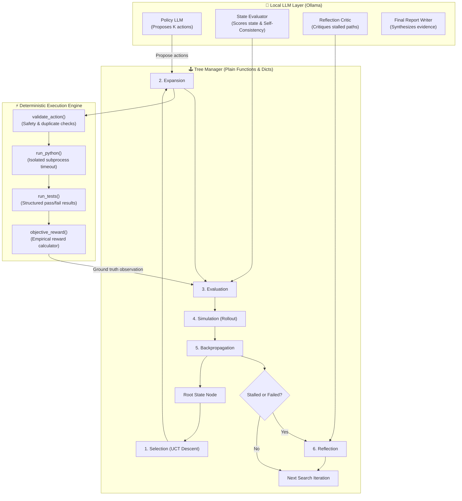
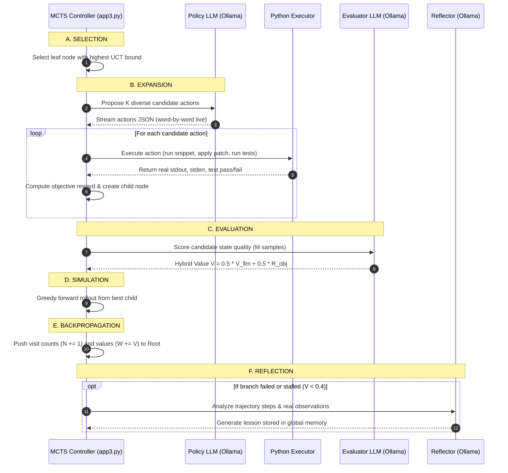

# 🌳 LATS Debugging Agent: Language Agent Tree Search

An autonomous, self-reflective code debugging and root-cause analysis agent powered by **Language Agent Tree Search (LATS)** and running **100% locally on Ollama** (featuring `qwen2.5-coder:7b`).

Built completely using a **plain-functions-only architecture** (no classes, states and nodes are plain dictionaries) with **live word-by-word streaming** of LLM reasoning and real-time execution in an isolated Python environment.

---

## 📌 Table of Contents
- [Why LATS for Debugging?](#-why-lats-for-debugging)
- [System Architecture](#-system-architecture)
- [The 6 LATS Operations](#-the-6-lats-operations)
- [Supported Local Models (Ollama)](#-supported-local-models-ollama)
- [Key Features](#-key-features)
- [Live Results & Output Walkthrough](#-live-results--output-walkthrough)
- [Mathematical Foundation](#-mathematical-foundation)
- [Project Layout](#-project-layout)
- [Getting Started](#-getting-started)
- [How to Run](#-how-to-run)

---

## 💡 Why LATS for Debugging?

Standard LLMs debug in a single linear chain of thought. If the model makes an incorrect initial assumption (e.g., *"the loop logic is broken"* when the real issue is an unguarded empty input), it gets trapped in hallucinations and rarely recovers.

**LATS replaces the single conversation chain with a Monte Carlo Tree Search (MCTS)**:
1. **The LLM is an Idea Generator & Evaluator**: It proposes diverse debugging actions (inspect, probe snippet, test, hypothesize, patch, conclude) and scores state quality.
2. **Ground Truth from Real Execution**: Observations are **never** fabricated by the LLM. An isolated Python subprocess executes the code and feeds ground-truth pass/fail tests and errors into the tree.
3. **Free Backtracking**: If an investigation branch fails or stalls, the tree automatically backtracks to explore alternative hypotheses.
4. **Self-Reflection as Cross-Branch Memory**: Failed paths trigger reflection prompts that critique what went wrong and append lessons into memory to steer future expansions.

---

## 🏗️ System Architecture



---

## 🔄 The 6 LATS Operations



---

## 🤖 Supported Local Models (Ollama)

This project runs 100% locally with **zero paid API keys** and **zero data leaving your machine**.

| Model | Size | Strengths | Configuration |
| :--- | :--- | :--- | :--- |
| **`qwen2.5-coder:7b`** *(Default)* | 4.7 GB | **Recommended.** Superior code comprehension, precise patch generation, strict JSON formatting. | `$env:OLLAMA_MODEL="qwen2.5-coder:7b"` |
| **`deepseek-coder:6.7b`** | 3.8 GB | Strong alternative specialized for coding and syntax reasoning. | `$env:OLLAMA_MODEL="deepseek-coder:6.7b"` |
| **`qwen2.5-coder:0.5b`** | 397 MB | **Fastest.** Ultra-lightweight; runs fast on CPU or modest laptops. | `$env:OLLAMA_MODEL="qwen2.5-coder:0.5b"` |
| **`qwen2.5:7b`** | 4.7 GB | General purpose instruction-tuned model. | `$env:OLLAMA_MODEL="qwen2.5:7b"` |

---

## ✨ Key Features

1. **No Classes Anywhere**:
   - The entire codebase is implemented with **plain functions and dictionaries** only.
   - States are dictionaries, nodes are dictionaries, and functions have strict unidirectional dependencies.
2. **Word-by-Word Live Streaming**:
   - Streams the LLM's step-by-step thinking tokens live in your terminal as it reasons about actions, state scores, and reflections.
3. **Transparent UCT Descent**:
   - Watch the selection algorithm step down each level of the tree, displaying candidate UCT values and showing why it picks specific paths.
4. **Sandboxed Subprocess Execution**:
   - Code execution runs via `subprocess.run([sys.executable, "-I", temp_file])` with timeout limits and keyword filters (`import os`, `subprocess`, `open(`, `eval(`, etc.).
5. **Automated Markdown Run Logger**:
   - Automatically records the complete execution history, live thoughts, tree branch diagram, and final synthesis into [`lats_run_log.md`](file:///c:/Users/tarun/OneDrive/Desktop/prepration/LATS/lats_run_log.md).

---

## 📊 Live Results & Output Walkthrough

### Target Bug: `calculate_average([])`
```python
def calculate_average(numbers):
    total = 0
    for n in numbers:
        total += n
    return total / len(numbers)
```
- **Observed Error**: `ZeroDivisionError: division by zero`
- **Contract Requirement**: Return `None` or raise a meaningful `ValueError`.

### 1. Terminal Live Streaming (What You See as it Runs)
```text
======================================================================
 [ITERATION 1/15] - 08:43:17
======================================================================

[1. SELECTION - UCT Tree Descent]
  -> REACHED LEAF Node #1 at depth 0 (action=ROOT, parent=#None)
     Leaf Statistics: visits N=1, avg Q=0.000, value_sum W=0.000

[2. EXPANSION]
  -> Node #1: Proposing 4 candidate actions...

  >>> Policy LLM: Proposing Actions & Reasoning:
  {
    "reasoning": "The function calculate_average receives numbers=[] and encounters ZeroDivisionError at total / len(numbers). To investigate, I should first inspect the return statement and probe len([])...",
    "actions": [
      {"type": "run_tests", "rationale": "Execute existing tests to observe which test cases fail"},
      {"type": "inspect_code", "focus": "return", "rationale": "Locate return statement where division occurs"},
      {"type": "run_snippet", "code": "print(len([]))", "rationale": "Confirm denominator evaluates to 0 for empty list"},
      {"type": "hypothesize", "hypothesis": "No guard for empty input list; contract undefined for calculate_average([])", "rationale": "Record leading hypothesis regarding unguarded division"}
    ]
  }

  - Action [run_tests]: VALID -> Generated Node #2 (depth=1)
  - Action [inspect_code]: VALID -> Generated Node #3 (depth=1)
  - Action [run_snippet]: VALID -> Generated Node #4 (depth=1)
  - Action [hypothesize]: VALID -> Generated Node #5 (depth=1)

  [3. EVALUATION] Node #5 (hypothesize):
      LLM Quality Score (V_llm) = 0.825
      Objective Reward  (R_obj) = 0.000
      Blended Value     (V)     = 0.412
```

### 2. The Final Explored Search Tree
```text
\-- [Node #1] ROOT (N=29, Q=0.60, R=0.00)
    |-- [Node #2] run_tests (N=1, Q=0.45, R=0.05)
    |-- [Node #3] inspect('return') (N=6, Q=0.44, R=0.05)
    |   |-- [Node #6] run_tests (N=1, Q=0.45, R=0.05)
    |   \-- [Node #7] snippet('print(len([]))') (N=3, Q=0.44, R=0.05)
    |-- [Node #4] snippet('print(len([]))') (N=6, Q=0.44, R=0.05)
    \-- [Node #5] hyp('No guard for empty input ...') (N=15, Q=0.78, R=0.00)
        |-- [Node #12] patch('h1') (N=8, Q=0.95, R=0.55)
        |   \-- [Node #15] conclude('calculate_average does no...') (N=8, Q=0.95, R=0.95) [SUCCESS]
        |-- [Node #13] snippet('print(calculate_average([1, 2, 3]))') (N=3, Q=0.62, R=0.05)
        \-- [Node #14] inspect('for n in numbers') (N=3, Q=0.62, R=0.05)
```

### 3. Final Root Cause Analysis Report Generated
```markdown
### Root Cause Analysis Report

- **Defect Summary**: Function `calculate_average` raises `ZeroDivisionError: division by zero` when called with an empty list `[]`.
- **Root Cause**: Unguarded division `total / len(numbers)` where `len([]) == 0`.
- **Evidence Grounding**: Confirmed by test execution (`e1`) and patch verification (`e3`, `fixed=1, broken=0`).
- **Contract Decision Note**: The function lacks an explicit contract for empty collections. Returning `None` vs raising `ValueError` is an API product design decision.
```

---

## 📐 Mathematical Foundation

### 1. Selection (UCT Formula)
$$\text{UCT}(s, a) = Q(s, a) + C \cdot \sqrt{\frac{\ln(\max(N(s), 1))}{N(s, a)}}$$
- **Exploitation term** $Q(s, a) = \frac{W(s, a)}{N(s, a)}$ prioritizes high-performing branches.
- **Exploration term** rewards infrequently visited nodes ($N(s, a) = 0 \implies \text{UCT} = +\infty$).
- $C = 1.0$ balances exploration and exploitation.

### 2. State Evaluation (Hybrid Value)
$$V(s) = \beta \cdot V_{\text{llm}}(s) + (1 - \beta) \cdot R_{\text{obj}}(s)$$
Where:
- $V_{\text{llm}}(s) = \lambda \cdot LM(s) + (1 - \lambda) \cdot SC(s)$
  - $LM(s)$: Direct LLM judgment score in $[0, 1]$.
  - $SC(s)$: Self-Consistency ratio across $M = 3$ samples for the leading hypothesis.
- $R_{\text{obj}}(s)$: Deterministic objective reward from sandbox execution facts:
  - $+0.15$ for reproducing the target error.
  - $+0.05$ per new piece of verified evidence.
  - $+0.20$ if a hypothesis is supported.
  - $+0.30$ if a patch fixes failing tests (and $-0.20$ if it breaks passing tests).

---

## 📁 Project Layout

```text
LATS/
├── app3.py               # Complete standalone, single-file LATS agent (Streaming + Ollama)
├── logger.py             # Plain-function logging system (Live terminal + markdown file)
├── lats_run_log.md       # Auto-generated full run report with ASCII tree and reasoning
├── prompts/              # System prompt specifications
│   ├── policy_prompt.txt
│   ├── evaluator_prompt.txt
│   └── reflection_prompt.txt
├── .gitignore            # Git exclusion rules
└── README.md             # Project documentation
```

---

## 🚀 Getting Started

### 1. Prerequisites
- **Python 3.10+**
- **[Ollama](https://ollama.com/)** installed and running on your system.

### 2. Pull Your Preferred Ollama Model
In your terminal, pull the recommended coding model:
```bash
ollama pull qwen2.5-coder:7b
```
*(Optional alternatives: `deepseek-coder:6.7b`, `qwen2.5-coder:0.5b`, or `qwen2.5:7b`)*

---

## 💻 How to Run

### Run with Default Model (`qwen2.5-coder:7b`):
```bash
python app3.py
```

### Run with a Different Local Model:
Set the `OLLAMA_MODEL` environment variable before running:

**PowerShell (Windows)**:
```powershell
# For ultra-fast lightweight execution:
$env:OLLAMA_MODEL = "qwen2.5-coder:0.5b"
python app3.py

# For DeepSeek Coder:
$env:OLLAMA_MODEL = "deepseek-coder:6.7b"
python app3.py
```

**Bash (Linux / macOS)**:
```bash
OLLAMA_MODEL="qwen2.5-coder:7b" python app3.py
```

After completion, open [`lats_run_log.md`](file:///c:/Users/tarun/OneDrive/Desktop/prepration/LATS/lats_run_log.md) to inspect the complete timestamped trace, descent path decisions, and the verified final root cause report.

